# Practical 05 — Wazuh and AlienVault OTX Threat Intelligence
> Security Monitoring & SOC | Practical 05

## Aim
To configure threat intelligence on the operating system and integrate it with Wazuh to collect, correlate, and detect indicators of compromise (IoCs) for improved security monitoring.

## Requirements
- Windows VM
- Wazuh Server and Wazuh Agent
- Sysmon
- AlienVault OTX (Open Threat Exchange)
- PowerShell 7

## Procedure / Steps
1. Verify that the Windows Wazuh agent (shown in the practical as `Win10-OTX`) is active in the Wazuh dashboard and that the Wazuh service is running on Windows.
2. Download and extract Sysmon. Install it with the supplied configuration, including:
   `Sysmon64.exe -accepteula -i C:\Sysmon\sysmonconfig.xml`
   This enables detailed Windows event collection, including DNS Query Event ID 22.
3. Configure the Windows agent's `ossec.conf` to collect the Sysmon event log. Enable `<logall_json>yes</logall_json>` on the Wazuh server so events are available in JSON format.
4. Clone the AlienVault OTX DNS statistics project:
   `git clone https://github.com/juaromu/wazuh-domain-stats-alienvault.git`
5. Copy `custom-dnsstats` and `custom-dnsstats.py` into `/var/ossec/integrations/`. Apply the ownership and executable permissions described in the practical.
6. Fetch the project tags, check out release `1.0`, and install the Python dependencies `six` and `python-whois`.
7. Install Flask and create `dnsstats_api.py` to provide the local DNS Statistics API used by the integration.
8. Configure the DNS Statistics API to process DNS queries and determine when a domain should be checked through OTX.
9. Verify the `custom-dnsstats` integration entry in `/var/ossec/etc/ossec.conf` and rule `100015` in `/var/ossec/etc/rules/local_rules.xml`. The rule links Sysmon DNS events to the `dnsstat_alert` group.
10. Install PowerShell 7 on Windows and verify it with `pwsh --version`. Download the `otx.ps1` script.
11. Create the Wazuh active-response directory on Windows and copy `otx.ps1` into it.
12. Create the `otx.cmd` wrapper so Wazuh can invoke the PowerShell 7 script.
13. Configure the OTX API key for the script. Keep API keys out of source control; use a local protected configuration or environment variable when publishing this repository.
14. Add and verify the Wazuh Active Response configuration so `otx.cmd` runs when `dnsstat_alert` is triggered.
15. Configure `custom-dnsstats.py` to process the Wazuh DNS alert, extract the queried domain, and communicate with the DNS Statistics API.
16. Create `alienvault_otx_rules.xml` under `/var/ossec/etc/rules/` to identify the JSON output from the OTX script and generate the **AlienVault OTX - Indicator(s) Found** alert.
17. Check the Windows active-response log. Generate a DNS test by flushing the DNS cache, resolving the test domain used in the lab, and checking Sysmon Event ID 22.
18. Verify that the event passes through the integration and that **AlienVault OTX - Indicator(s) Found** appears in the Wazuh dashboard.

## Expected Result
A Sysmon DNS query event is collected by Wazuh, processed through the DNS statistics and OTX integration, and results in an OTX indicator alert when matching threat intelligence is returned. The active-response log records the OTX result.

## Conclusion
In this practical, Wazuh was integrated with AlienVault OTX for threat intelligence and IoC detection. Sysmon was configured on the Windows VM to generate DNS Query Event ID 22, which was collected by the Wazuh agent. The required DNS statistics, integration, rule, and Active Response components were configured on the Wazuh server. PowerShell and the OTX script were configured on Windows to query AlienVault OTX for detected domains. A test DNS query was generated and its Sysmon event was verified. The OTX response was recorded in the active-response log, and the AlienVault OTX - Indicator(s) Found alert was successfully generated in the Wazuh Dashboard.

## Screenshots

### 48-win10-otx-agent-connected-and-services
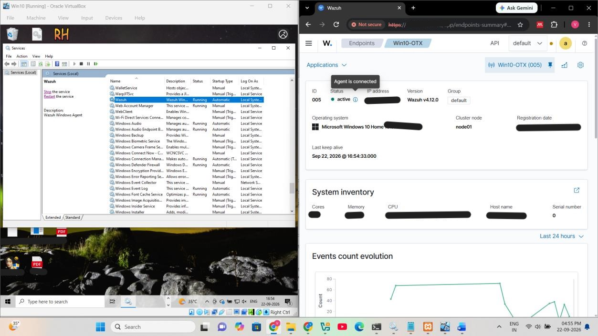

### 49-sysmon-install-powershell
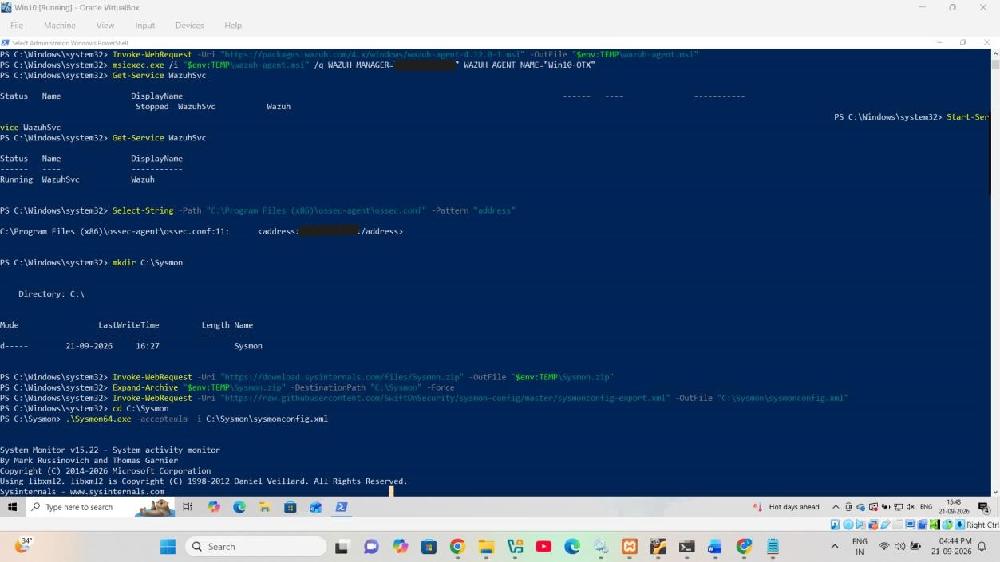

### 50-ossec-conf-sysmon-and-manager-ossec-conf
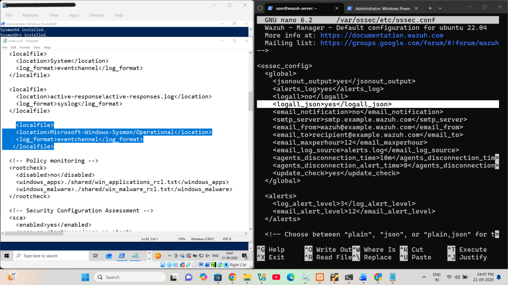

### 51-git-clone-wazuh-domain-stats-alienvault
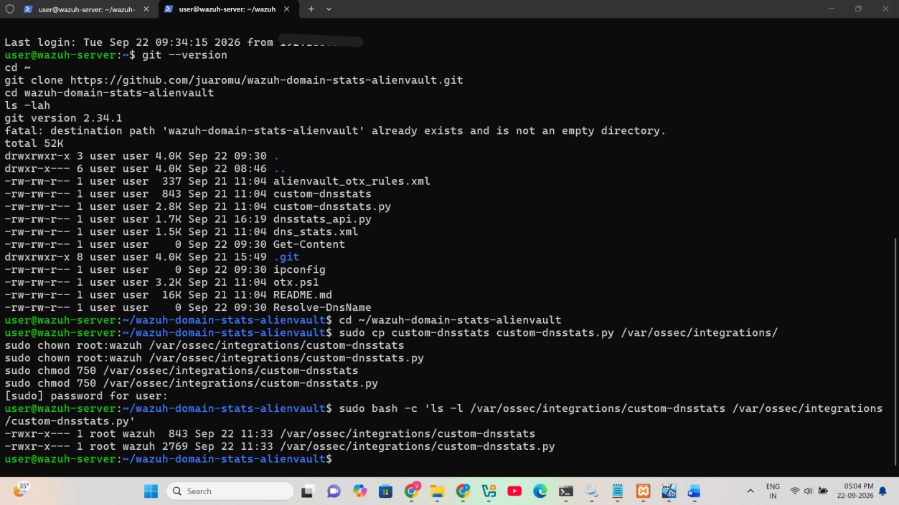

### 52-git-checkout-domain-stats-release
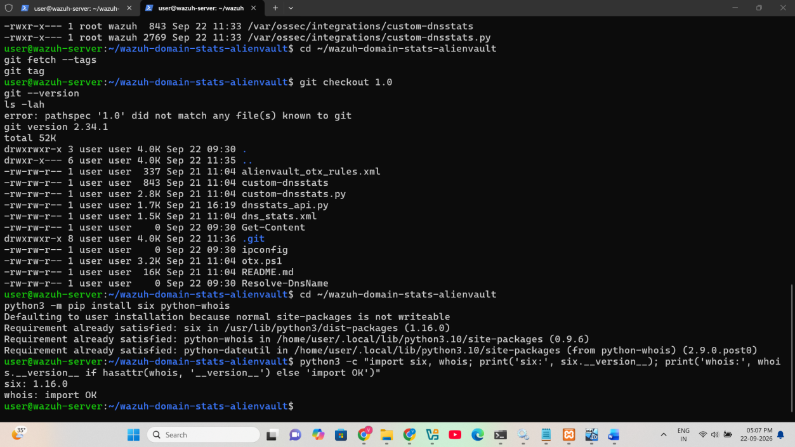

### 53-pip-install-flask-and-whois
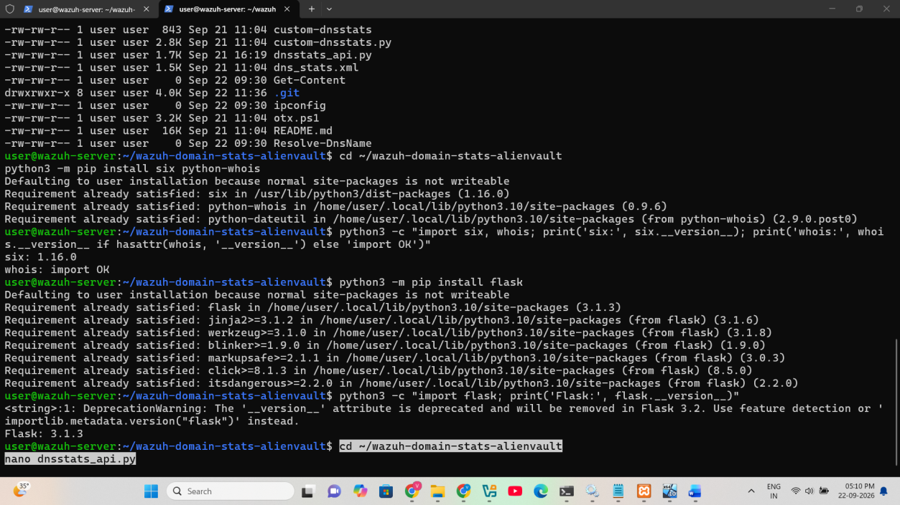

### 54-dnsstats-api-py-code-part-1
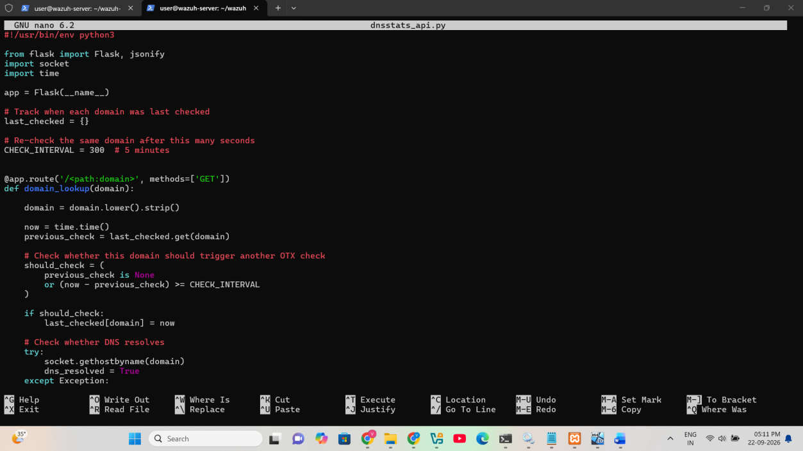

### 55-dnsstats-api-py-code-part-2
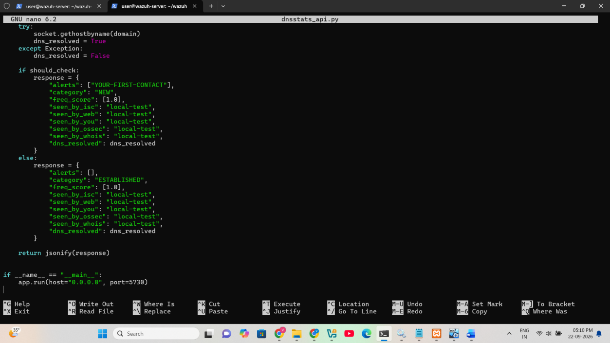

### 56-ossec-conf-integration-and-rule-100015
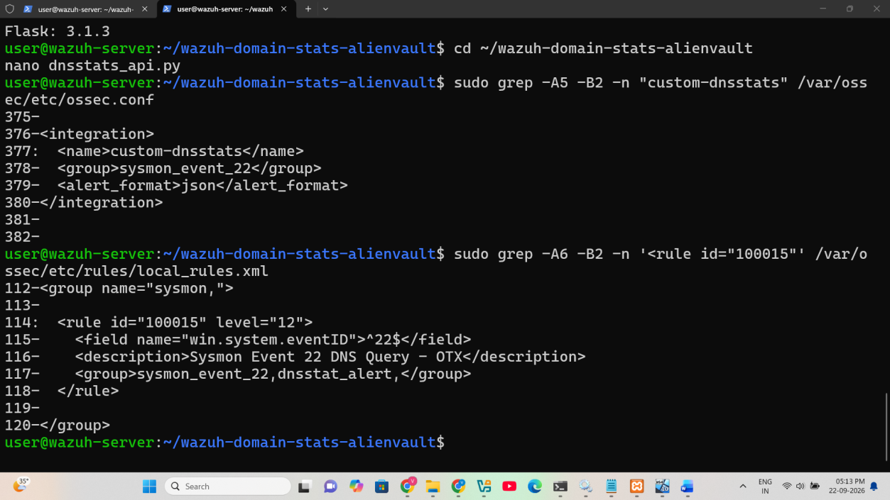

### 57-otx-ps1-download-via-http-server
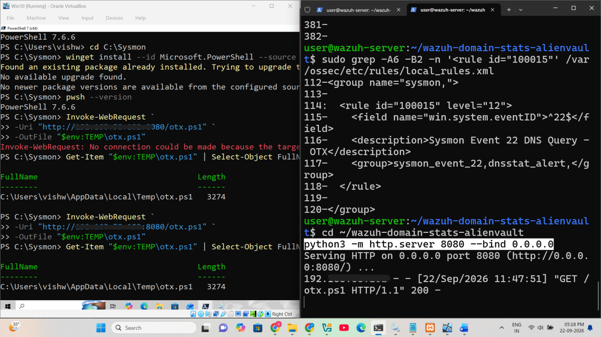

### 58-active-response-folder-otx-files
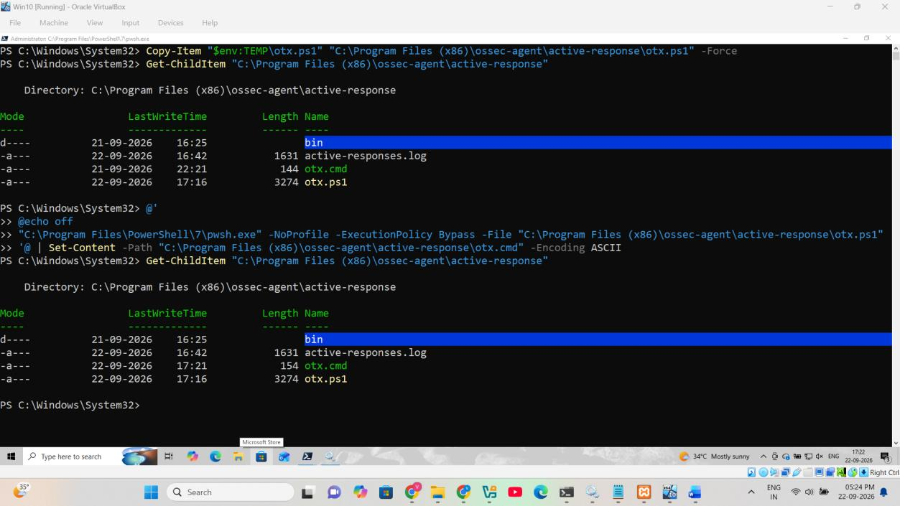

### 59-otx-ps1-script-and-otx-api-page
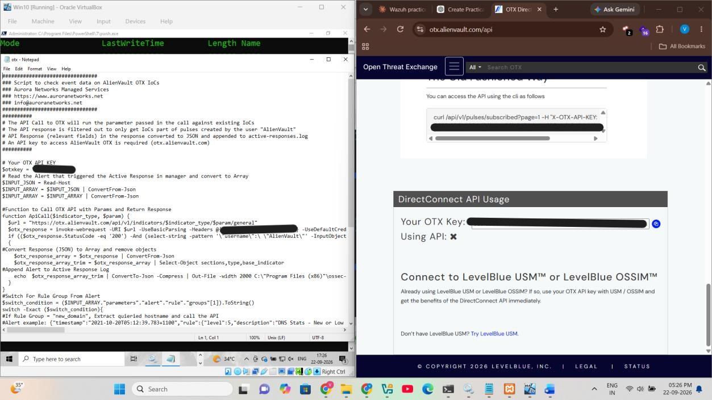

### 60-ossec-conf-active-response-alienvault-otx
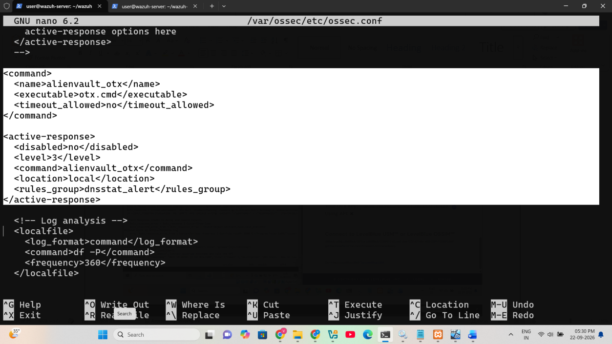

### 61-custom-dnsstats-py-script
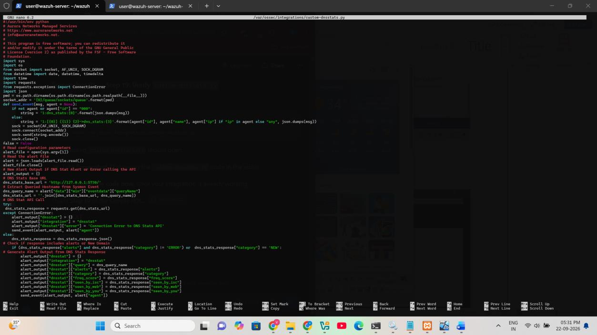

### 62-alienvault-otx-rules-xml
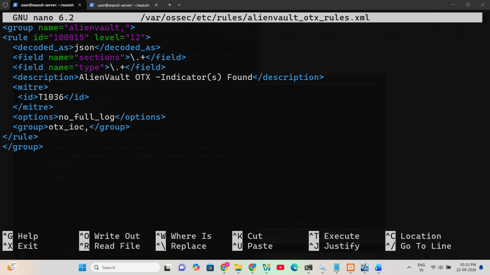

### 63-otx-active-responses-log
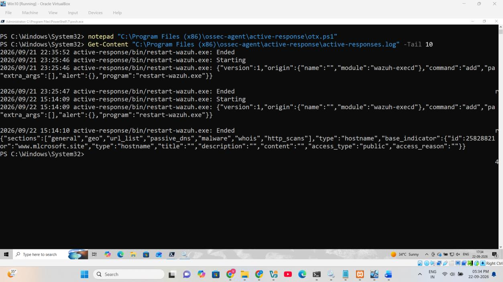

### 64-flushdns-and-sysmon-event-22
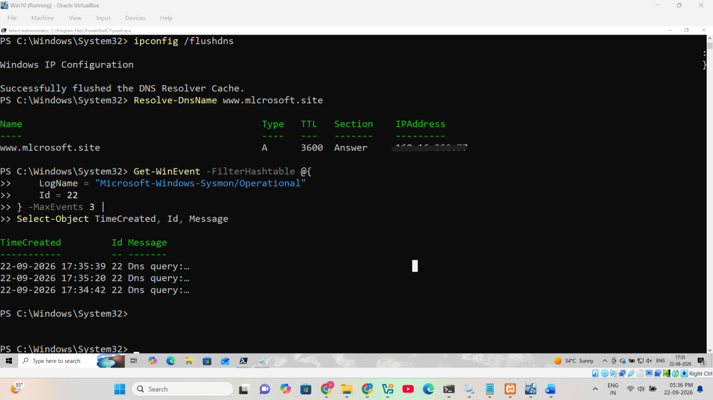

### 65-threat-hunting-alienvault-otx-rule-100815
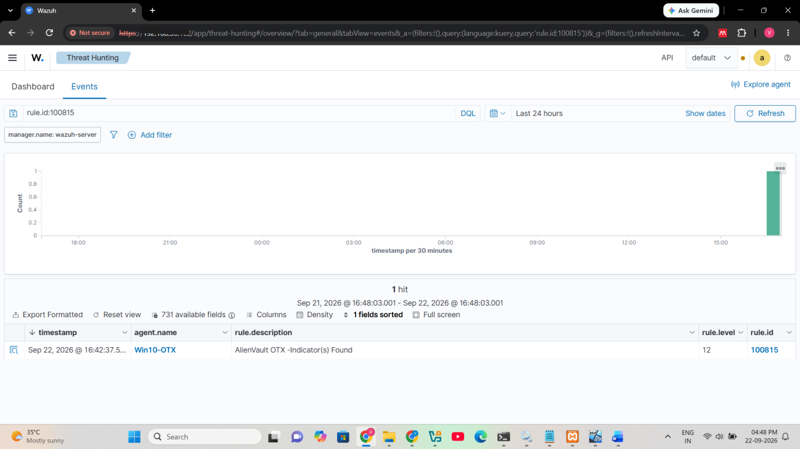
